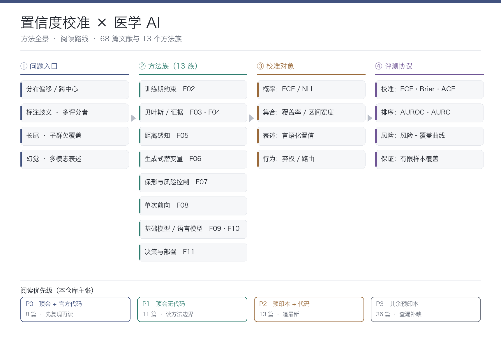
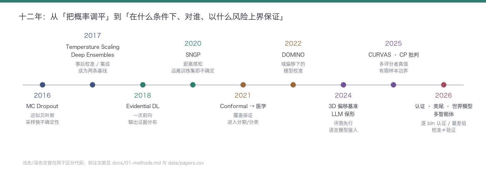

# 🎯 Confidence Calibration Roadmap

> **置信度校准（Confidence Calibration）研究路线与资源整理**：方法对比 · 顶会论文 · 实验室地图 · 多场景应用。
> 文献底座为 2024–2026 年医学 AI 校准/不确定性方向的 **68 篇论文**，按"顶会 + 有源代码优先"的原则组织成可执行的阅读路线。

<p align="center">
  
</p>

---

## 📖 关于本项目

这个项目把"置信度校准"这个方向拆成 **四件可以动手做的事**：

```text
┌──────────────┐
│  对比方法     │ → 13 个方法族：原理、成本、保证、失效方式、怎么选
└────┬─────────┘
     ↓
┌──────────────┐
│  论文清单     │ → P0~P3 四级优先级，顶会+官方代码的先读先复现
└────┬─────────┘
     ↓
┌──────────────┐
│  实验室地图   │ → 国内外团队：谁在做什么、盯梢谁、合作找谁
└────┬─────────┘
     ↓
┌──────────────┐
│  多场景应用   │ → 12 个医疗场景 + 数据集地图 + 已知陷阱
└──────────────┘
```

> **建议使用方式：**
> 先看 [方法对比](#-01--方法全景) 建立框架 → 按优先级清单读论文、跑代码 → 用 [场景地图](#-04--多场景应用) 找自己的选题落点。

---

# 🗺️ Roadmap

| 模块 | 内容 | 快速入口 |
| :---: | :--- | :--- |
| 🧭 01 | [**方法全景**](#-01--方法全景) | 13 个方法族对比 + 选型决策树 |
| 📄 02 | [**论文清单**](#-02--论文清单) | P0~P3 优先级 + 代码链接 |
| 🏫 03 | [**实验室地图**](#-03--实验室地图) | 国内外团队与盯梢策略 |
| 🏥 04 | [**多场景应用**](#-04--多场景应用) | 12 个场景 + 数据集 + 陷阱 |
| 🛠️ 05 | [**开源工具箱**](#-05--开源工具箱) | 基线代码库与评测工具 |
| 📅 06 | [**阅读计划**](#-06--阅读计划) | 8 周精读 + 复现排期 |

---

# 🧭 01 · 方法全景

完整版（含选型矩阵、失效分析、决策树、演进时间线）→ **[docs/01-methods.md](docs/01-methods.md)**

十三族方法一图速览：

| 方法族 | 一句话 | 代表工作（本库） | 给保证？ |
| :-- | :-- | :-- | :--: |
| **F02 训练期约束** | 用损失/增强在训练时就压过自信 | Focal Calibration Loss；不确定性驱动训练（2026） | ❌ |
| **F03 贝叶斯近似** | MC Dropout / Deep Ensembles 近似后验 | PULPo（MICCAI 24）；乳腺超声分割（MICCAI 25） | ❌ |
| **F04 证据深度学习** | Dirichlet 证据参数化不确定性 | 证据校准分割（2023 谱系） | ❌ |
| **F05 距离感知** | 离训练集越远越不确定 | SNGP（ISBI 2026） | ❌ |
| **F06 生成式潜变量** | 建模数据分布导出不确定性 | MedSymmFlow（MICCAI 25）；Patch-PODiff-ViT（2026） | ❌ |
| **F07 保形与风险控制** | 校准集分位数 → 覆盖保证的集合/区间 | LLM 保形（NeurIPS 24）；COMPASS；CARE；ConVolt | ✅ |
| **F08 单次前向 UQ** | 冻结骨干 + 轻量不确定性头 | SegWithU（MICCAI 26）；MedFormer-UR（2026） | ❌ |
| **F09 基础模型校准** | VLM/MLLM 的提示校准与置信表达 | CalibPrompt（BMVC 25）；MLLM 公平校准（MICCAI 25） | 部分 |
| **F10 语言模型/多智能体** | 序列熵、一致性交叉验证 | 多智能体一致性 MCQA（2026）；校准≠验证（2026） | 部分 |
| **F11 决策与部署** | 弃权/级联/治理层/世界模型 | MedBayes-Lite；云边级联（2026）；CalTwin | 部分 |
| **F12 分布式与隐私** | 联邦个性化校准 | TrustFed（2026）；FedOAP（2025） | ❌ |
| **F13 评测与理论** | 基准、认证、有限样本理论 | CURVAS（MICCAI 25）；CP 批判（2025）；CalCErt（2026） | ✅ |

**三条铁律**（2025–2026 文献反复验证）：

1. 校准（ECE）≠ 排序（AUROC）≠ 保证（覆盖）——三个指标要分开报。
2. 温度缩放不改排序；只优化校准可能伤害挑错能力。
3. 边际覆盖 ≠ 子群覆盖：长尾病种上"平均 90%"可能是"最差组 60%"。

---

# 📄 02 · 论文清单

完整分级清单（含每篇的价值说明）→ **[docs/02-papers.md](docs/02-papers.md)** · 逐篇索引 → **[docs/papers-index.md](docs/papers-index.md)**

文献库 68 篇的优先级分布：

| 级别 | 定义 | 篇数 | 策略 |
| :--: | :-- | :--: | :-- |
| **P0** | 顶会/顶刊 + 官方代码 | 8 | 逐行精读 + 复现 |
| **P1** | 顶会/顶刊，无官方代码 | 11 | 精读方法，结论待验证 |
| **P2** | 预印本 + 代码 | 13 | 追最新，代码直接改 |
| **P3** | 其余预印本 | 36 | 泛读查漏 |

### P0 必读（顶会 + 官方代码，8 篇）

| # | 论文 | 会议 | 代码 |
| :-: | :-- | :--: | :-- |
| 01 | PULPo: Probabilistic Unsupervised Laplacian Pyramid Registration | MICCAI 2024 | [GitHub](https://github.com/leonardsiegert/PULPo) |
| 02 | Trustworthy Breast Tumor Segmentation (MC Dropout × Deep Ensembles) | MICCAI 2025 | [GitHub](https://github.com/toufiqmusah/caladan-mama-mia) |
| 03 | FISHing in Uncertainty: Synthetic Contrastive Learning | MICCAI 2024 | [GitHub](https://github.com/SimonBon/FISHing) |
| 04 | MedSymmFlow: Symmetrical Flow Matching | MICCAI 2025 | [GitHub](https://github.com/caetas/MedSymmFlow) |
| 05 | LLM Validity via Enhanced Conformal Prediction | NeurIPS 2024 | [GitHub](https://github.com/jjcherian/conformal-safety) |
| 06 | CalibPrompt: Calibration-Aware Prompt Learning | BMVC 2025 | [GitHub](https://github.com/iabh1shekbasu/CalibPrompt) |
| 07 | Calibration Biases & Unfairness in MLLM Few-Shot ICL | MICCAI 2025 | [GitHub](https://github.com/xingbpshen/medical-calibration-fairness-mllm) |
| 08 | Evaluating Reasoning Faithfulness in Medical VLMs | ML4H 2025 | [数据集](https://huggingface.co/datasets/jomoll/TAIX-VQA) · [代码](https://github.com/jomoll/cot-eval) |

---

# 🏫 03 · 实验室地图

完整版（三梯队 + 盯梢策略）→ **[docs/03-labs.md](docs/03-labs.md)**

**三个梯队**：

- **梯队 A · 文献库中出现的团队**（单位信息确凿）：Stanford 统计（Candès）/ BDS（Shah）、Rice ECE（Balakrishnan）、MPI Tübingen（Schölkopf）、McGill（Arbel）、TU Munich CAMP（Navab）、Paris-Saclay（Vakalopoulou）、TU Eindhoven、JHU、NYU、Columbia DBMI、Wisconsin-Madison 等约 25 个团队——读他们的论文就是读最新动态。
- **梯队 B · 国际公认 UQ/校准中心**：Oxford OATML（Gal）、Berkeley（Angelopoulos）、ETH（Krause）、CMU（Lipton）等，related work 的经典地基。
- **梯队 C · 国内团队**（按方向整理）：清华 TSAIL（贝叶斯/安全 AI）、上海 AI Lab（OpenMEDLab）、港中文医学影像、中科院自动化所、腾讯觅影/联影智能/华为云医疗（部署侧）等。

> 2024–2026 的方法学热点（条件覆盖、认证、风险控制）国内系统性输出还少——**综述 + 方法的空白窗口仍在**。

---

# 🏥 04 · 多场景应用

完整版（12 场景 × 难点 × 模板论文 × 数据集 + 四个已知陷阱）→ **[docs/04-applications.md](docs/04-applications.md)**

| 场景 | 校准难点 | 模板论文 |
| :-- | :-- | :-- |
| 2D/3D 分割 | 像素不确定性无真值；预测集体积失控 | SegWithU、CURVAS |
| 影像分类 | 长尾过自信；跨中心漂移 | SNGP (ISBI 26)、CXR-LT 2026 |
| 检测/筛查 | 框级置信聚合；端侧算力 | 端侧疟疾 (MICCAI 26) |
| 配准 | 形变场无监督信号 | PULPo |
| 报告生成/VQA | 逐句置信、幻觉 | Conrad (2026)、Medical VQA (COLM 26) |
| 临床文本 | 生成内容的风险控制 | CARE (2026) |
| EHR/风险预测 | 跨队列漂移、模态缺失 | FoMoH、Calibration-First 哮喘 |
| 放疗/数字孪生 | 治疗日影像未知 | CalTwin、数字孪生框架 (2026) |
| 联邦/隐私 | 通信约束下个性化校准 | TrustFed、FedOAP |

**公开数据集地图**（哪个集能支撑哪类校准实验）：LIDC-IDRI（标注分歧⭐）、CXR-LT（长尾/多中心）、ACDC/M&Ms（跨中心分割）、BraTS/LiTS（3D UQ）、ISIC（长尾分类）、MIMIC-CXR / VQA-RAD / TAIX-VQA（文本与 VQA）、MIMIC-III/IV（EHR）……

---

# 🛠️ 05 · 开源工具箱

> 经典基线与通用工具（社区整理，链接以对应仓库为准）；本库论文的官方代码见 [docs/02-papers.md](docs/02-papers.md) 与 [papers-index](docs/papers-index.md)。

| 工具 | 用途 | 链接 |
| :-- | :-- | :-- |
| **uncertainty-baselines** | Google 出品，SNGP / Deep Ensembles / BatchEnsemble 复现基准 | [GitHub](https://github.com/google/uncertainty-baselines) |
| **conformal-prediction** | Angelopoulos & Bates 保形预测教程（CP 入门第一站） | [GitHub](https://github.com/aangelopoulos/conformal-prediction) |
| **MAPIE** | scikit-learn 生态的保形预测库（回归/分类/时序） | [GitHub](https://github.com/scikit-learn-contrib/MAPIE) |
| **torch-uncertainty** | PyTorch 的 UQ 训练/评测一体化库 | [GitHub](https://github.com/ENSTA-U2IS-AI/torch-uncertainty) |
| **focal_calibration** | Focal Loss 校准官方实现（F02 谱系） | [GitHub](https://github.com/torrvision/focal_calibration) |
| **MONAI** | 医学影像框架，3D 分割 UQ 实验的底座 | [GitHub](https://github.com/Project-MONAI/MONAI) |
| **torchmetrics** | ECE / CalibrationError 等指标实现 | [GitHub](https://github.com/Lightning-AI/torchmetrics) |
| **OpenMEDLab** | 开源医学基础模型平台 | [GitHub](https://github.com/openmedlab) |

---

# 📅 06 · 阅读计划

8 周精读 + 复现排期（每周主题 / 任务 / 产出）→ **[docs/05-reading-plan.md](docs/05-reading-plan.md)**

```text
第1-2周   理论主线 + VLM 校准       → 保形预测笔记 · 提示校准对照表
第3-4周   贝叶斯基线 + 生成式路线   → 成本-收益表 · 生成式差异分析
第5-6周   保形进阶 + 单次前向       → 条件化覆盖对比 · SegWithU 重实现
第7-8周   评测协议 + 选题整合       → LIDC 数据管线 · 2 页 proposal
```

---

# 📐 方法演进时间线

<p align="center">
  
</p>

从"把概率调平"（2016–2021）→"给出保证"（2021–2024）→"结构化与行为化"（2025–2026）：
**校准对象已从概率扩展到集合、表述与行为；校准与验证正在被明确切开。**

---

# 📊 数据与结构

```text
Confidence-Calibration-Roadmap/
├── README.md                  ← 你在这里
├── assets/                    ← 全景图 / 时间线
├── docs/
│   ├── 01-methods.md          ← 方法梳理与对比（核心）
│   ├── 02-papers.md           ← P0~P3 优先级清单
│   ├── 03-labs.md             ← 国内外实验室地图
│   ├── 04-applications.md     ← 多场景应用 + 数据集 + 陷阱
│   ├── 05-reading-plan.md     ← 8 周阅读计划
│   └── papers-index.md        ← 68 篇逐篇索引（自动生成）
├── data/
│   └── papers.csv             ← 文献数据库（18 个字段）
└── scripts/
    └── build_index.py         ← 从 CSV 重新生成索引
```

维护方式：更新 `data/papers.csv` → 运行 `python scripts/build_index.py` → 索引自动刷新。

---

# 🔄 Roadmap Updates

计划逐步加入：

- [ ] 每季度同步一次 P2 层新论文（arXiv + 代码）
- [ ] 补充各方法族的复现笔记（notes/）
- [ ] 增加非医疗场景（自动驾驶 / 遥感 / 大模型）的迁移案例
- [ ] 国内外实验室动态月报
- [ ] 英文版 README

---

# 🤝 Contributing

如果你发现：

* 📄 值得收录的顶会论文（尤其有代码的）
* 🛠️ 更好用的校准工具库
* 🏫 需要校正的实验室信息
* 🏥 新的应用场景或数据集

欢迎提交 Issue 或 Pull Request。文献收录标准：**2024 年以后 · 顶会/顶刊优先 · 有官方代码优先**。

---

<p align="center">

**Keep Calibrating · Keep Reproducing · Keep Questioning 🎯**

</p>
