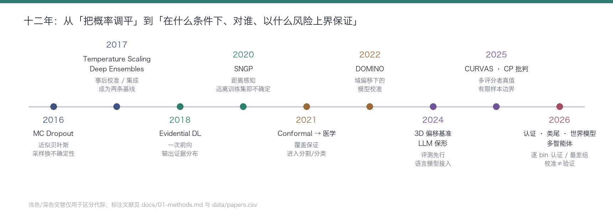

# 🧭 01 · 方法梳理与对比

> 本文档对置信度校准 / 不确定性量化（UQ）的方法进行体系化梳理。
> 所有"代表工作"均出自本仓库文献库（2024–2026，见 [data/papers.csv](../data/papers.csv)），方法演进史见文末时间线。

---

## 0. 三个基本概念（30 秒版）

| 概念 | 一句话 | 例子 |
| :-- | :-- | :-- |
| **校准（Calibration）** | 模型说的"我有 90% 把握"，在同类样本上真的对 90% | 分类器输出 0.9 的那批样本，实际准确率应约 90% |
| **排序（Discrimination）** | 错的样本置信度是否普遍低于对的样本 | AUROC / AURC |
| **保证（Coverage Guarantee）** | 能给出数学上成立的覆盖 / 风险上界 | "预测集包含真值的概率 ≥ 90%"（保形预测） |

**关键教训（2025–2026 年多篇论文反复验证）**：校准 ≠ 排序 ≠ 保证。
温度缩放能把 ECE 降下来，但不改变排序（AUROC 不动）；只优化校准的模型，挑错能力反而可能变差。

---

## 1. 十三个方法族速览

| # | 方法族 | 一句话原理 | 需要重训？ | 给保证？ | 典型开销 | 本库代表工作 |
| :-- | :-- | :-- | :--: | :--: | :-- | :-- |
| F01 | 概率论与度量基础 | ECE / Brier / NLL 的定义与分解，校准误差的来源分析 | — | — | — | 理论综述类（见 F13） |
| F02 | 训练期校准约束 | 用损失 / 正则 / 数据增强在训练时就"压制"过自信 | ✅ | ❌ | 重训一次 | Focal Calibration Loss；不确定性驱动训练（肺结节）；增强对校准的影响（MIUA 2026） |
| F03 | 贝叶斯近似 | MC Dropout / Deep Ensembles / 变分推断近似后验 | 半 | ❌ | N 次前向 | Deep Bayesian 结肠息肉分割；PULPo 配准；MC Dropout+集成乳腺超声 |
| F04 | 证据深度学习 | 用 Dirichlet 分布参数化类别证据，单次前向输出不确定性 | ✅ | ❌ | 1 次前向 | 证据校准分割（Evidential Calibrated UQ） |
| F05 | 距离 / 谱范数感知 | 特征归一化 + GP 头，"离训练集越远越不确定" | ✅ | ❌ | 1 次前向 | SNGP 生物医学分类（ISBI 2026） |
| F06 | 生成式与潜变量 | VAE / 流匹配 / 扩散建模数据分布，从生成过程导不确定性 | ✅ | ❌ | 重 | MedSymmFlow（对称流匹配）；Patch-PODiff-ViT；FISHing 合成对比 |
| F07 | 保形预测与风险控制 | 用校准集做分位数统计，输出有覆盖保证的预测集 / 区间 | ❌ | ✅ | 一个校准集 | LLM 保形校准（NeurIPS 2024）；形态学预测集；COMPASS；CARE；ConVolt；类尾覆盖修正 |
| F08 | 单次前向确定性 UQ | 扰动探针 / 置信度头，一次前向同时出分割与不确定性 | 半 | ❌ | 轻量头 | SegWithU（MICCAI 2026）；MedFormer-UR 不确定性路由 |
| F09 | 基础模型 / 多模态校准 | 对 VLM / MLLM / 医学基础模型做提示校准、置信表达、公平性 | 部分 | ❌ | 微调 / 推理期 | CalibPrompt（BMVC 2025）；MLLM 少样本校准公平性（MICCAI 2025）；放射报告置信表达 |
| F10 | 语言模型与多智能体 | 序列熵、一致性验证、多智能体交叉校验来估计置信 | 部分 | 部分 | 多次推理 | 词序列熵（医疗 QA）；多智能体一致性（MCQA）；校准≠验证（MoA 路由） |
| F11 | 决策层与部署治理 | 弃权 / 级联 / 治理层 / 世界模型，把不确定性变成"下一步动作" | ❌ | 部分 | 策略层 | MedBayes-Lite 治理层；置信门控云边级联；CalTwin 世界模型；端侧疟疾筛查 |
| F12 | 分布式与隐私 | 联邦学习下的个性化校准、差分隐私对校准的影响 | ✅ | ❌ | 通信开销 | TrustFed；个性化联邦分割（FedOAP） |
| F13 | 评测、基准与理论 | 多维基准、有限样本理论、认证协议、跨任务评测 | — | ✅ | — | CURVAS 挑战赛；CP 有限样本批判；CalCErt 逐 bin 认证；FOCUS；CXR-LT 2026 |

> F01 不单独成文，融入 F13 与各族的失效分析。

---

## 2. 六个维度的硬对比（选型矩阵）

给一个新任务选校准方案时，按这张表走：

| 维度 | 贝叶斯近似 F03 | 证据/距离感知 F04·F05 | 生成式 F06 | 保形预测 F07 | 单次前向 F08 | 决策治理 F11 |
| :-- | :-- | :-- | :-- | :-- | :-- | :-- |
| **能否改写模型输出** | 概率平滑 | 概率+OOD | 概率重参数化 | 输出集合/区间 | 不动硬分割 | 不动模型，动策略 |
| **分布偏移下表现** | 集成较稳，MC Dropout 差 | OOD 检测强（AUROC 高） | 中等 | ⚠️ 可交换性破坏即失效 | 未验证跨中心 | 明确按风险分层 |
| **空间结构保留** | 像素级（贵） | 弱（多用于分类） | 像素级 | ⚠️ 需形态学/连通性修正 | 像素级图 | — |
| **训练改造成本** | 高（N 模型/N 前向） | 中（改网络头） | 高（生成模型） | 零（训练后处理） | 低（冻结骨干+小头） | 零（策略层） |
| **推理开销** | N×（5–20 倍） | 1× | 1–2× | 校准集+排序 | ~1×（重骨干 1 次） | 1×+门控 |
| **理论保证** | ❌ | ❌ | ❌ | ✅ 边际覆盖 | ❌ | 风险上界（部分） |
| **医疗落地阻力** | 显存/延迟 | 需重训 | 训练不稳定 | 集合不直观、需解释 | 需额外标注训练头 | 流程改造 |

### 2.1 各族的"典型失效方式"（比优点更重要）

- **F02 训练期约束**：对不同数据分布需要重新调损失权重；数据增强对校准的影响方向不定（MIUA 2026：同一技巧在皮肤镜上可正可负）。
- **F03 贝叶斯近似**：MC Dropout 在医学 3D 任务上系统性欠估计；集成成员相关性会吃掉大部分收益；部署侧显存 × N。
- **F04/F05**：证据过高估计 OOD；SNGP 对特征提取器敏感，基础模型时代需要重新调。
- **F06 生成式**：生成模型的校准与判别指标常常脱节（MedSymmFlow 用对称结构对齐两者，但这正说明默认情况是不对齐的）。
- **F07 保形预测**：三大软肋——①可交换性被时间/中心结构悄悄破坏；②边际覆盖 ≠ 子群覆盖（长尾病种远低于 90%）；③分割任务的预测集没有体积控制（需要 ConVolt / 形态学约束）。有限样本下的实际覆盖也可能低于名义值（Max Planck 2025 批判）。
- **F08 单次前向**：不确定性头需要带标注的数据训练；跨中心能否保住排序能力未经验证（SegWithU 自己承认）。
- **F09/F10**：MLLM 的 token 概率与真实正确性弱相关，few-shot 示例会引入人口学子群校准偏差；多智能体一致性带来 3–10 倍推理成本。
- **F11**：弃权阈值依赖"置信度与错误率单调"的假设——如果上游没校准好，门控就是在错误的地基上盖楼。

---

## 3. 方案选型决策树

```text
你的约束是什么？
│
├─ 「模型已经上线，不能动」
│   ├─ 有标注校准集（几百~几千例）？
│   │   ├─ 要"预测集/区间" → 保形预测 F07（分类：APS；分割：形态学/体积控制；回归：分位数 CP）
│   │   ├─ 只要"更准的概率" → 温度缩放 / 向量缩放 F01（注意：不改排序）
│   │   └─ 要"决策"（弃权/转诊） → 风险–覆盖曲线选阈值 F11
│   └─ 没有校准集 → 只能走训练期方案或重新收集校准集（没有捷径）
│
├─ 「可以从头训练」
│   ├─ 分类任务，要 OOD 检测 → SNGP F05 / 证据学习 F04
│   ├─ 分割任务，要像素级不确定性 → SegWithU 式轻量头 F08；预算充足 → Deep Ensembles F03
│   └─ 数据本身有歧义（多评分者） → 把分歧当监督信号（F02 + CURVAS 协议）
│
└─ 「医疗部署硬约束」
    ├─ 延迟/显存紧张（3D 体数据） → 单次前向 F08，别用 20 次前向的 MC Dropout
    ├─ 端侧/边缘 → 置信门控级联（云-边-端）F11
    └─ 数据不能出院 → 联邦校准 F12（注意个性化与全局校准的冲突）
```

---

## 4. 方法演进时间线



三个代际的关注点变化：

1. **2016–2021「调平概率」**：MC Dropout、温度缩放、Deep Ensembles、证据学习、SNGP，核心问题是"ECE 怎么降"。
2. **2021–2024「给出保证」**：保形预测进入医学影像与 NLP，覆盖保证替代点估计；评测开始强调分布偏移（3D 分割偏移基准）。
3. **2025–2026「结构化与行为化」**：子群/类尾条件覆盖、逐 bin 认证（CalCErt）、风险控制实体抽取、校准与验证切开（C-MoA）、世界模型校准（CalTwin）、多智能体一致性。**校准对象从"概率"扩展到"集合、表述、行为"。**

---

## 5. 与本仓库文献的对应关系

每篇论文的完整字段（方法族 / 难点 / 数据集 / 代码）见 [data/papers.csv](../data/papers.csv)，
自动生成的逐篇索引见 [docs/papers-index.md](papers-index.md)。

**当前文献库的方法族分布**（68 篇，2024–2026）：

| 方法族 | 篇数 | 方法族 | 篇数 |
| :-- | :--: | :-- | :--: |
| F07 保形预测与风险控制 | 11 | F03 贝叶斯近似 | 7 |
| F13 评测基准与理论 | 12 | F11 决策与部署治理 | 7 |
| F09 基础模型/多模态校准 | 10 | F02 训练期约束 | 6 |
| F10 语言模型/多智能体 | 5 | F06 生成式与潜变量 | 5 |
| F12 分布式与隐私 | 2 | F08 单次前向 | 2 |
| F05 距离/谱范数感知 | 1 | F04 证据深度学习 | 0* |

> \* 证据学习在 2024–2026 的新增文献中明显退潮，被保形预测与单次前向方法取代——这本身就是一个值得在综述里指出的趋势。

---

## 参考（本库核心方法学论文）

1. Cherian, Gibbs, Candès. *Large Language Model Validity via Enhanced Conformal Prediction Methods*. NeurIPS 2024.
2. Kladny, Schölkopf, Koch, Baumgartner, Muehlebach. *A Critical Perspective on Finite Sample Conformal Prediction Theory in Medical Applications*. arXiv 2025.
3. Cheung et al. *COMPASS: Robust Feature Conformal Prediction for Medical Segmentation Metrics*. 2025.
4. Fillioux et al. *CalCErt: Bin-wise Certification of Confidence Calibration in Medical Image Classification*. 2026.
5. Fu et al. *SegWithU: Deterministic Perturbation Probes for Single-Backbone-Pass Risk-Aware Medical Image Segmentation*. MICCAI 2026.
6. Meleti, Nirschl. *Uncertainty-Aware Image Classification in Biomedical Imaging Using SNGP*. ISBI 2026.
7. Riera-Marín et al. *CURVAS: Calibration and Uncertainty for multiRater Volume Assessment in Multiorgan Segmentation*. MICCAI 2025.
